# Yes Bank Analytics

An interactive Tableau project for exploring stakeholder insights, insurer performance, premium trends, profitability, and assets under management. The dashboard combines KPI summaries and analytical views to support data-driven exploration.

## Dashboard Preview

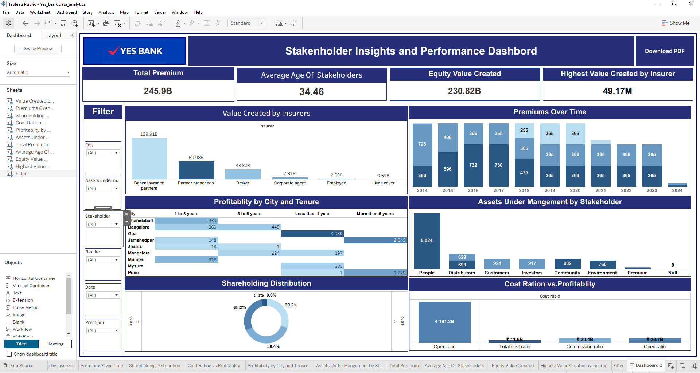

## Project Overview

The project uses Tableau to present business metrics from the Finance record data source. The accompanying *Stakeholder Insights and Performance Dashboard* document describes the intended analysis and dashboard requirements.

### Objectives

- Compare value created across insurers.
- Explore premium trends over time.
- Review stakeholder shareholding patterns.
- Examine cost-ratio categories alongside value created.
- Compare profitability counts by city and policy tenure.
- Explore assets under management by stakeholder.
- Provide headline KPIs for premium, stakeholder age, equity value created, and highest insurer value created.

## Key Performance Indicators (KPIs)

### Total Premium

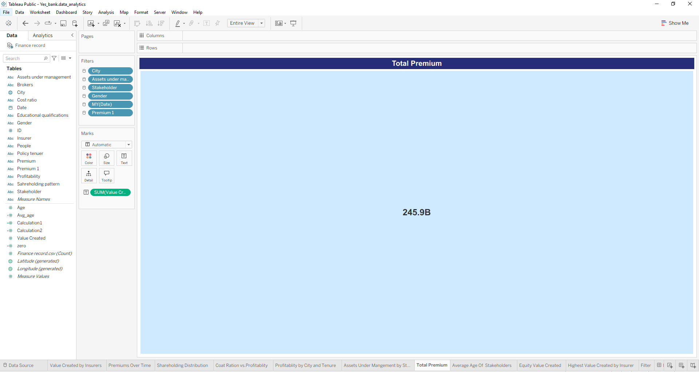

The displayed workbook KPI is **245.9B**.

### Average Age of Stakeholders

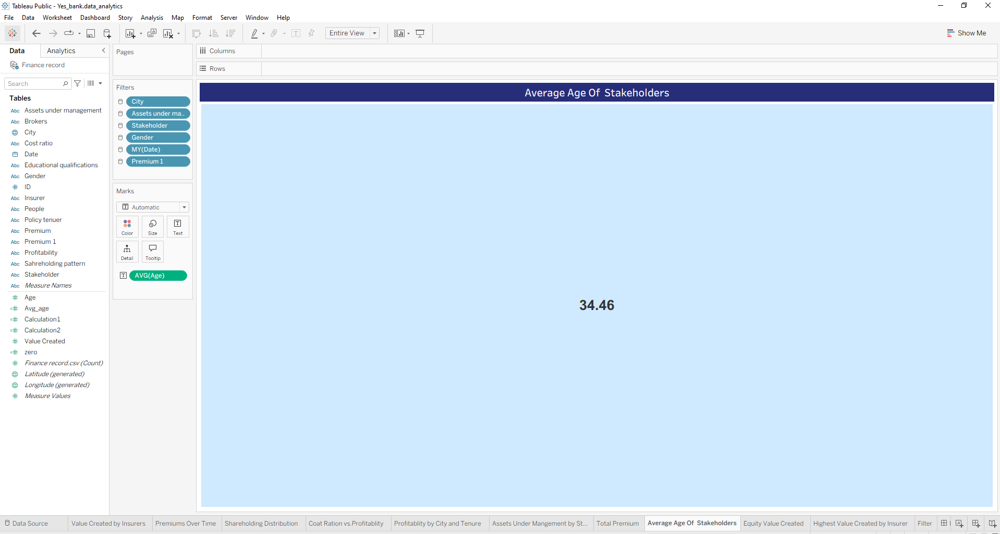

The displayed workbook KPI is **34.46**.

### Equity Value Created

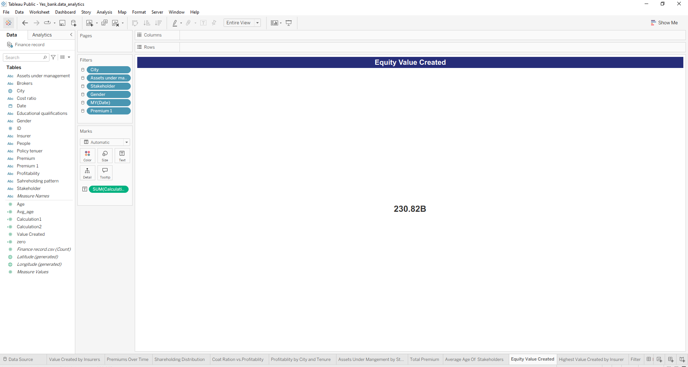

The displayed workbook KPI is **230.82B**.

### Highest Value Created by Insurer

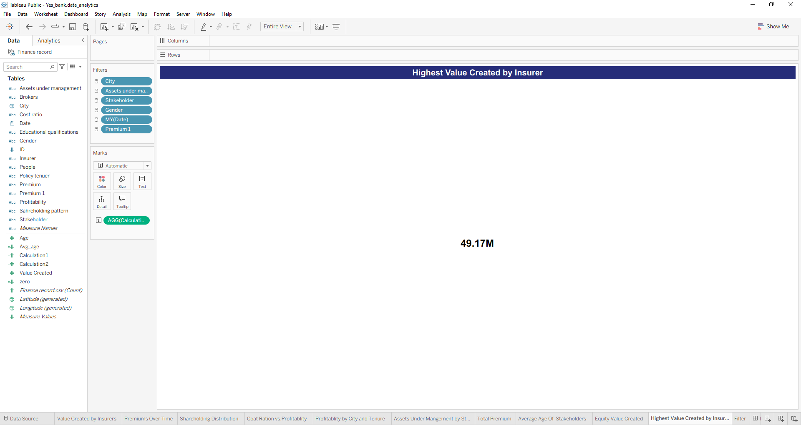

The displayed workbook KPI is **49.17M**.

## Charts and Analysis

### 1. Value Created by Insurers

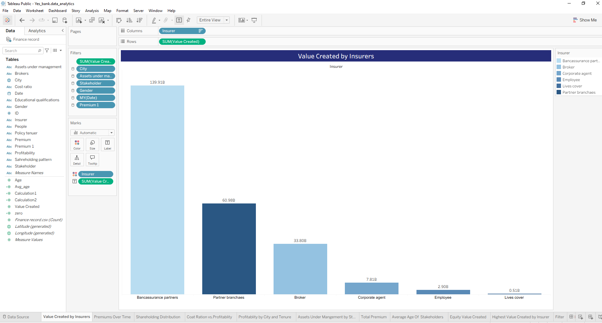

Compares value created across insurer categories. In the captured view, Bancassurance partners have the largest displayed value (139.91B), followed by Partner branches (60.98B) and Broker (33.80B).

### 2. P
remiums Over Time
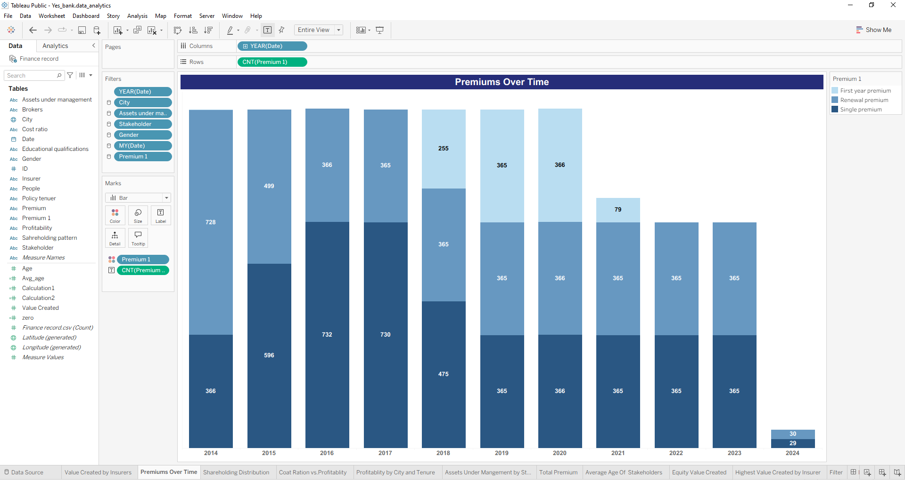

Shows the distribution of premium records by year and premium type from 2014 to 2024. The latest year shown may represent a partial period.

### 3. Shareholding Distribution

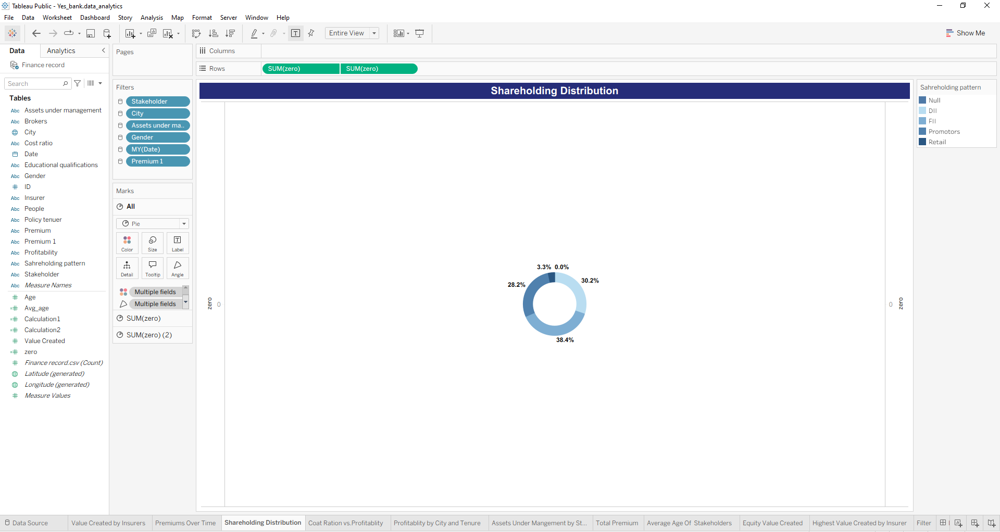

Displays the shareholding-pattern breakdown. The captured view labels segments at 38.4%, 30.2%, 28.2%, 3.3%, and 0.0%.

### 4. Cost Ratio vs. Profitability

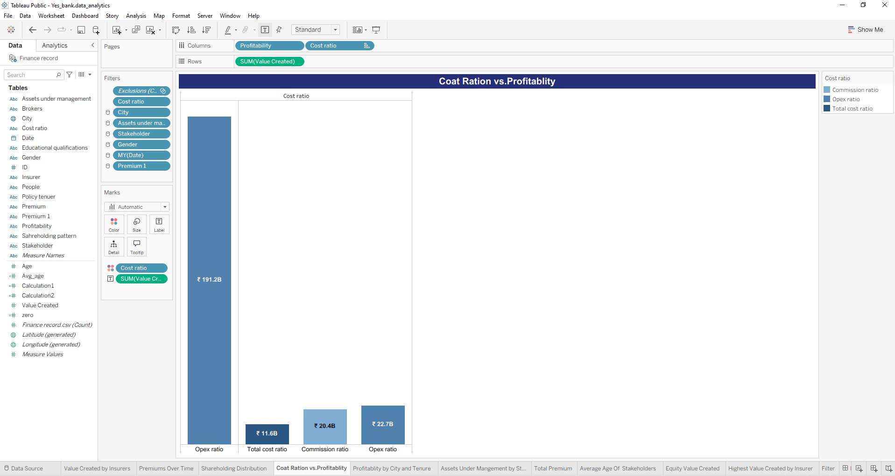

Compares value created across cost-ratio categories. The worksheet title contains a spelling variation; this README uses the intended wording.

### 5. Profitability by City and Policy Tenure

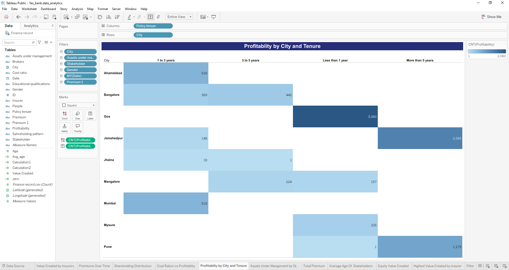

Compares the count of profitability records across cities and policy-tenure categories. The strongest visible count in this capture is Goa / Less than 1 year (3,080).

### 6. Assets Under Management by Stakeholder

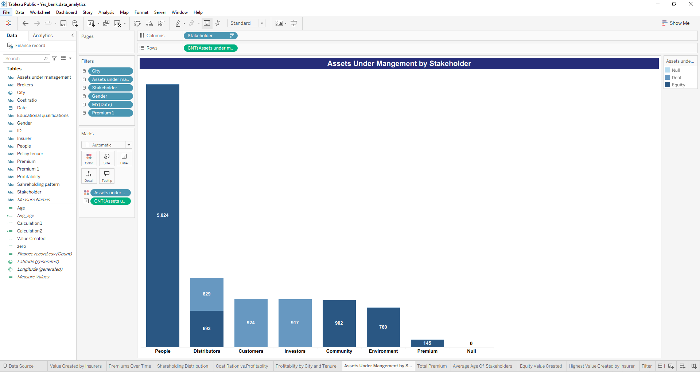

Shows counts across stakeholder groups and assets-under-management categories. The captured view shows People as the largest group (5,024).

## Filters and Interactivity

The dashboard screenshot shows filters for City, Assets under management, Stakeholder, Gender, Date, and Premium.

The project specification also calls for interactive chart filtering, hover tooltips, and dynamically updated KPIs. Confirm each interaction in Tableau when presenting the workbook as a finished project.

## Export and Access Requirements

The reference specification lists these intended capabilities:

- A PDF export button for visible charts, KPIs, and filters.
- A light company-branding watermark on exported PDFs.
- Role-based access for stakeholders with different data visibility levels.

The dashboard screenshot includes a **Download PDF** button. The watermark and role-based access requirements should be verified separately before claiming they are implemented.

## Project Files

- `Yes_bank.data_analytics.twbx` — packaged Tableau workbook.
- `Stakeholder Insights and Performance Dashboard.docx` — dashboard requirements reference.
- `screenshots/` — actual screenshots of the dashboard, charts, and KPI worksheets.
- `README.md` — project documentation.

## How to Open the Project

1. Open `Yes_bank.data_analytics.twbx` in Tableau Desktop or a compatible Tableau application.
2. If prompted, confirm the data connection or refresh settings.
3. Select **Dashboard 1** to view the complete dashboard.
4. Open individual worksheet tabs to inspect each analysis.
5. Use the filters to explore different slices of the available data.

## Author

Akshay Mahadik,[ GitHub profile](https://github.com/Akshay-mahadik007)
